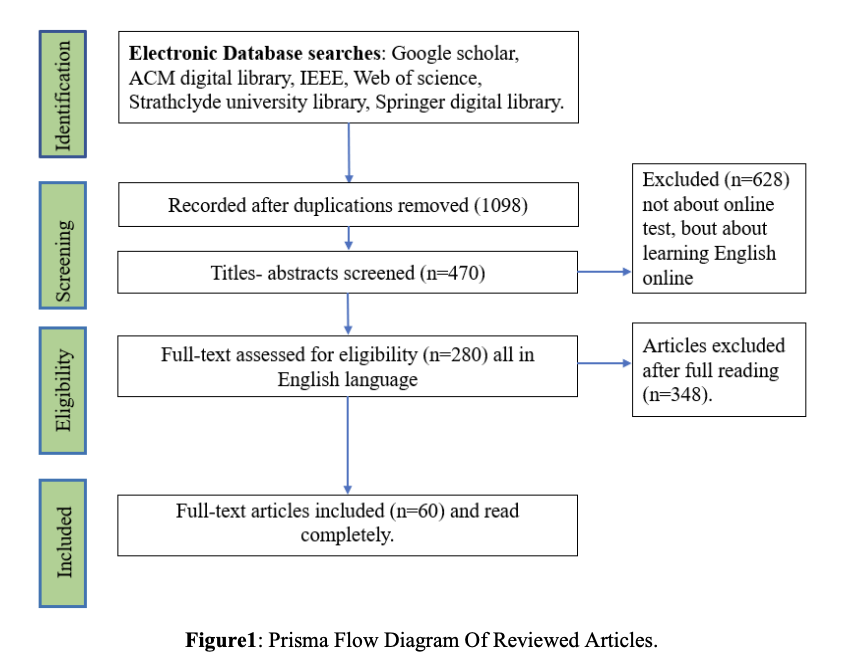

{fig-align="center"}

```{r}
library(DiagrammeR)
```

```{r}
# Do poprawy wg wzoru
grViz("
  digraph PRISMA {
    graph [layout = dot, rankdir = TB, nodesep = 0.5, ranksep = 0.7]

    node [shape = box, style = filled, fillcolor = white, color = grey35, width = 3.9, height = 0.8, fontsize = 10]

    # Nagłówki sekcji
    h_id   [label = 'Identification', fillcolor = lightgoldenrod1, fontsize = 12]
    h_scr  [label = 'Screening', fillcolor = lightgoldenrod1, fontsize = 12]
    h_inc  [label = 'Included', fillcolor = lightgoldenrod1, fontsize = 12]

    # Kolumna: bazy i rejestry
    db_rec   [label = 'Records identified from:\nDatabases (n = )\nRegisters (n = )']
    db_rem   [label = 'Records removed before screening:\nDuplicate records removed (n = )\nMarked ineligible by automation tools (n = )\nRemoved for other reasons (n = )']
    db_scr   [label = 'Records screened\n(n = )']
    db_exc   [label = 'Records excluded\n(n = )']
    db_ret   [label = 'Reports sought for retrieval\n(n = )']
    db_nret  [label = 'Reports not retrieved\n(n = )']
    db_elig  [label = 'Reports assessed for eligibility\n(n = )']
    db_reas  [label = 'Reports excluded:\nReason 1 (n = )\nReason 2 (n = )\nReason 3 (n = )']

    # Kolumna: inne metody
    om_rec   [label = 'Records identified from:\nWebsites (n = )\nOrganisations (n = )\nCitation searching (n = )\netc. (n = )']
    om_ret   [label = 'Reports sought for retrieval\n(n = )']
    om_nret  [label = 'Reports not retrieved\n(n = )']
    om_elig  [label = 'Reports assessed for eligibility\n(n = )']

    # Wynik końcowy
    inc_st   [label = 'Studies included in review\n(n = )']
    inc_rep  [label = 'Reports of included studies\n(n = )']

    # Układ rang
    {rank = same; h_id; h_scr; h_inc}
    {rank = same; db_rec; om_rec}
    {rank = same; db_ret; om_ret}
    {rank = same; db_nret; om_nret}
    {rank = same; db_elig; om_elig}

    # Przepływ: databases/registers
    h_id  -> db_rec
    db_rec -> db_rem -> db_scr -> db_ret -> db_elig -> inc_st -> inc_rep
    db_scr -> db_exc [minlen = 2]
    db_ret -> db_nret [minlen = 2]
    db_elig -> db_reas [minlen = 2]

    # Przepływ: other methods
    h_id  -> om_rec
    om_rec -> om_ret -> om_elig -> inc_st
    om_ret -> om_nret [minlen = 2]

    # Powiązanie nagłówków
    h_scr -> db_scr [style = invis]
    h_inc -> inc_st [style = invis]

  }
")
```
